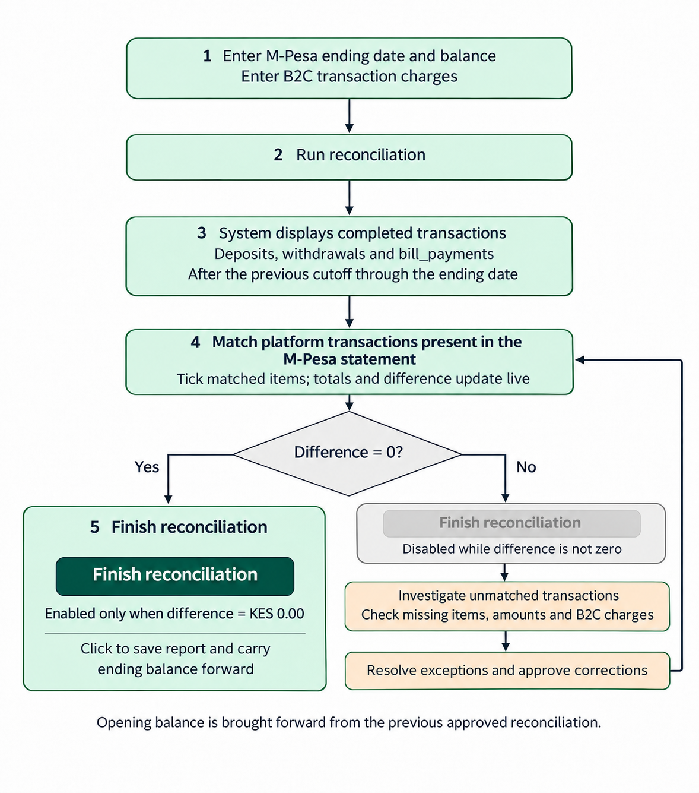

# M Pesa Reconciliation Software Requirements

**Document purpose:** SRS ready requirements for the WasaaChat M Pesa reconciliation module  
**Owner:** Finance Revenue Analyst  
**Audience:** Product Engineering Quality Assurance Finance Operations and Audit  
**Version:** 1.0  
**Date:** 18 November 2026  
**Status:** Draft for incorporation into the product SRS

## Purpose

This specification defines the behavior required for a finance user to reconcile platform transactions to an M Pesa statement. The module must bring forward the previous approved closing position, show completed platform transactions for the selected period, allow the user to match transactions that are present in the M Pesa statement, calculate the difference using the approved business formula, and permit completion only when the difference is exactly KES 0.00.

The M Pesa statement is used as the preparer reference during matching. Importing the M Pesa statement is not a step in this workflow.

## Scope

The module covers completed KES platform transactions associated with the reconciled M Pesa account and classified as deposits, withdrawals, or bill payments. It also captures the M Pesa ending date and balance and the total B2C transaction charges for the period.

The module excludes pending, failed, cancelled, duplicated, unsupported currency, internal transfer, and out of period transactions. Investigation or posting of corrections may occur in connected operational processes, but the reconciliation must be recalculated after those corrections are applied.

## Business outcome

A successful reconciliation produces a completed and locked record containing the period inputs, opening position, scoped transactions, matched transactions, calculation components, zero difference, completion user, completion time, and carry forward position for the next reconciliation.

## Actors and responsibilities

| Actor | Responsibility |
|---|---|
| Finance preparer | Enters the ending position and B2C charges, runs the reconciliation, matches platform transactions present in the M Pesa statement, investigates differences, and finishes a balanced reconciliation. |
| Finance reviewer or checker | Approves corrections or exception resolutions where maker checker control applies. |
| Finance lead | Authorizes the first opening position, exceptional reopening, or other actions reserved by finance policy. |
| System | Brings forward the opening position, retrieves eligible transactions, calculates totals and difference, controls the Finish reconciliation button, saves the completed snapshot, and carries the ending position forward. |

## Definitions

| Term | Definition |
|---|---|
| Opening cutoff | Exact ending date and time of the previous approved reconciliation. Transactions at this timestamp are excluded from the new period. |
| Opening balance | Closing balance of the previous approved reconciliation. It is locked for the new period. |
| Ending cutoff | M Pesa ending date and time entered for the current reconciliation. Transactions at this timestamp are included. |
| Closing balance | M Pesa ending balance entered for the current ending cutoff. |
| B2C transaction charges | Total M Pesa B2C charges entered for the reconciliation period and counted once in the difference. |
| Matched transaction | A platform transaction the preparer confirms is present in the M Pesa statement. |
| Bill payment | A completed platform transaction with canonical type `bill_payment`. The interface displays this as Bill payment or Bill payments. |
| Difference | Result of the authoritative business formula defined in this specification. |
| Completed reconciliation | An immutable reconciliation with a difference of exactly KES 0.00 that has been finished by an authorized user. |

## Process flow

1. The preparer enters the M Pesa ending date and balance and the B2C transaction charges.
2. The preparer selects Run reconciliation.
3. The system displays completed deposits, withdrawals, and bill payments strictly after the previous approved cutoff and through the ending cutoff.
4. The preparer matches platform transactions present in the M Pesa statement.
5. The system updates matched totals and the difference immediately.
6. If the difference is not zero, Finish reconciliation remains disabled and the preparer investigates unmatched transactions, amounts, B2C charges, and missing or incorrect records. Approved corrections return the user to matching and recalculation.
7. If the difference is exactly KES 0.00, Finish reconciliation becomes enabled. Selecting it saves the completed report and carries the ending cutoff and balance forward.

## Preconditions

- The user is authenticated and authorized to prepare M Pesa reconciliations.
- The M Pesa account to be reconciled is identified.
- A previous approved reconciliation supplies the opening cutoff and balance, or an authorized first opening position has been configured.
- Completed platform transactions are available to the reconciliation service.
- The user has the M Pesa statement available for comparison.

## Functional requirements

| ID | Requirement |
|---|---|
| REC FR 001 | The system shall identify the M Pesa account being reconciled. |
| REC FR 002 | The system shall display the locked opening cutoff and opening balance from the previous completed reconciliation for the same account. |
| REC FR 003 | When no previous completed reconciliation exists, the system shall require an authorized first opening cutoff, opening balance, and evidence reference before a reconciliation can run. |
| REC FR 004 | The system shall allow the preparer to enter the M Pesa ending date and time in Africa Nairobi time. |
| REC FR 005 | The system shall allow the preparer to enter the M Pesa closing balance in KES with no more than two decimal places. |
| REC FR 006 | The system shall allow the preparer to enter total B2C transaction charges in KES with no more than two decimal places. |
| REC FR 007 | The system shall validate that the ending cutoff is later than the opening cutoff. |
| REC FR 008 | The system shall reject missing, negative, malformed, or unsafe monetary values. |
| REC FR 009 | The system shall provide an explicit Run reconciliation action after the mandatory inputs are valid. |
| REC FR 010 | The system shall not populate or replace the reconciliation transaction schedule merely because an input field changed. Transaction population shall occur when the user selects Run reconciliation. |
| REC FR 011 | When Run reconciliation is selected, the system shall retrieve completed platform transactions strictly after the opening cutoff and at or before the ending cutoff. |
| REC FR 012 | The retrieved transaction set shall include canonical types `deposit`, `withdrawal`, and `bill_payment`. |
| REC FR 013 | The system shall exclude pending, failed, cancelled, internal transfer, duplicate, non KES, unsupported type, and out of period transactions. |
| REC FR 014 | The system shall sort the reconciliation transaction schedule from oldest to newest by the authoritative completion timestamp. |
| REC FR 015 | The system shall display the transaction timestamp, platform reference, M Pesa reference when available, transaction type, counterparty, amount, and match status. |
| REC FR 016 | The system shall show separate amount columns or totals for deposits, withdrawals, and bill payments. |
| REC FR 017 | The preparer shall be able to mark a platform transaction as matched when it is present in the M Pesa statement. |
| REC FR 018 | The preparer shall be able to unmatch a transaction before the reconciliation is completed. |
| REC FR 019 | The system shall record the user, timestamp, and method for every match or unmatch action. |
| REC FR 020 | Search, filtering, sorting, and pagination shall not change the scoped transaction set or calculated totals. |
| REC FR 021 | A bulk match action shall apply only to the explicitly described filtered set and shall remain reversible before completion. |
| REC FR 022 | The system shall calculate and display matched deposit total, matched withdrawal total, matched bill payment total, B2C charges, opening balance, closing balance, and difference. |
| REC FR 023 | The system shall recalculate totals and difference immediately after a match, unmatch, or permitted input change. |
| REC FR 024 | The system shall use the exact difference formula defined under Calculation rules. |
| REC FR 025 | The Finish reconciliation button shall remain visible but disabled while the difference is not exactly KES 0.00. |
| REC FR 026 | The interface shall explain that Finish reconciliation is disabled because the difference is not zero. |
| REC FR 027 | The Finish reconciliation button shall become enabled when the difference is exactly KES 0.00 and the current run remains valid. |
| REC FR 028 | The system shall revalidate the difference on the server or authoritative application layer when Finish reconciliation is selected. |
| REC FR 029 | A nonzero difference shall not be bypassed through direct requests, stale interface state, rounding, filtering, or client side manipulation. |
| REC FR 030 | When the difference is nonzero, the reconciliation shall remain in progress and support investigation of unmatched transactions, amounts, B2C charges, and missing or incorrect records. |
| REC FR 031 | The system shall allow an exception to record its type, transaction reference, amount, reason, owner, due date, status, evidence reference, maker, checker, and correction reference. |
| REC FR 032 | After an approved correction is applied, the system shall refresh or rerun the transaction schedule and return the preparer to matching. |
| REC FR 033 | On successful completion, the system shall save an immutable snapshot of inputs, scoped transactions, match decisions, totals, difference, user, and timestamps. |
| REC FR 034 | On successful completion, the system shall set the completed closing balance and ending cutoff as the opening balance and cutoff of the next reconciliation for the same account. |
| REC FR 035 | The system shall prevent completed reconciliation periods from overlapping for the same M Pesa account. |
| REC FR 036 | The system shall provide a readable completed reconciliation report and machine readable transaction detail. |
| REC FR 037 | Reopening a completed reconciliation shall require authorization, a reason, and a retained audit history. |

## Calculation rules

The following formula is the authoritative business rule and shall be implemented exactly as written:

**Difference = Closing balance - Opening balance + Matched deposits - Matched withdrawals - B2C transaction charges - Matched bill payments**

All components use KES cents internally. The displayed result uses two decimal places. The system shall not replace this expression with a differently signed balance bridge unless the product owner formally changes this requirement.

| Component | Rule |
|---|---|
| Closing balance | User entered M Pesa ending balance for the current cutoff. |
| Opening balance | Locked closing balance from the previous approved reconciliation. |
| Matched deposits | Sum of matched completed `deposit` transactions in the period. |
| Matched withdrawals | Sum of matched completed `withdrawal` transactions in the period. |
| B2C transaction charges | User entered period charge total. It is deducted once. |
| Matched bill payments | Sum of matched completed `bill_payment` transactions in the period. |

The B2C charge total shall not also be included as transaction rows unless the data model and formula are changed to prevent double counting.

## Transaction eligibility rules

| Rule | Required behavior |
|---|---|
| Status | Only completed transactions are eligible. |
| Currency | Only KES transactions are eligible. |
| Account | Transactions must belong to the M Pesa account being reconciled. |
| Opening boundary | A transaction exactly at the opening cutoff is excluded. |
| Ending boundary | A transaction exactly at the ending cutoff is included. |
| Timestamp | Completed time is authoritative. If the source lacks completed time, the limitation must be documented and approved before creation time is used. |
| Type | Eligible canonical types are `deposit`, `withdrawal`, and `bill_payment`. |
| Duplicate | A stable transaction identifier shall prevent duplicate inclusion. Conflicting records with the same identifier shall block the run until resolved. |

## Reconciliation states

| State | Entry condition | Allowed actions | Exit condition |
|---|---|---|---|
| Draft | Inputs are being prepared or are invalid. | Edit inputs and save draft. | Valid inputs and Run reconciliation selected. |
| In progress | Eligible transactions have been populated. | Match, unmatch, search, filter, investigate, and save. | Difference becomes zero or corrections require a rerun. |
| Difference outstanding | Difference is not KES 0.00. | Investigate, record exceptions, correct inputs where permitted, and rerun. Finish remains disabled. | Difference becomes KES 0.00. |
| Ready to finish | Difference is exactly KES 0.00. | Finish reconciliation or continue reviewing and unmatching. | Finish selected or difference becomes nonzero. |
| Completed | Finish validation succeeded and snapshot was saved. | View and export. | Authorized reopening only. |
| Reopened | An authorized user reopened a completed run with a reason. | Apply controlled corrections and rerun. | A new completed version is saved with retained history. |

## User interface requirements

- Step one shall group Ending date and time, Closing balance, and B2C transaction charges.
- Run reconciliation shall be a distinct primary action.
- The results area shall label platform transactions as completed deposits, withdrawals, and bill payments for the exact reconciliation period.
- The matching instruction shall read **Match platform transactions present in the M Pesa statement**.
- Each transaction row shall provide an accessible match control with a clear selected state.
- The opening balance, closing balance, matched totals, charges, and difference shall remain visible while matching.
- Difference shall display a sign and two decimal places.
- Finish reconciliation shall be labeled in full. It shall show a disabled visual state and explanatory text until Difference equals KES 0.00.
- When enabled, Finish reconciliation shall use a clear primary action style.
- The completed view shall show the run as locked and identify the next opening position.

## Data requirements

### Reconciliation record

| Field | Type | Required | Rule |
|---|---|---|---|
| reconciliation_id | Stable identifier | Yes | Unique and immutable. |
| account_id | Identifier | Yes | Identifies the M Pesa account. |
| opening_cutoff | Timestamp | Yes | Stored with timezone and displayed in EAT. |
| opening_balance_cents | Integer | Yes | Locked from prior completed run. |
| ending_cutoff | Timestamp | Yes | Later than opening cutoff. |
| closing_balance_cents | Integer | Yes | Nonnegative. |
| b2c_charges_cents | Integer | Yes | Nonnegative and counted once. |
| matched_deposits_cents | Integer | Yes | Derived. |
| matched_withdrawals_cents | Integer | Yes | Derived. |
| matched_bill_payments_cents | Integer | Yes | Derived. |
| difference_cents | Integer | Yes | Derived using the authoritative formula. |
| status | Enum | Yes | One of the approved reconciliation states. |
| created_by and created_at | Audit fields | Yes | Immutable audit data. |
| completed_by and completed_at | Audit fields | Completed only | Written on successful finish. |
| prior_reconciliation_id | Identifier | Except first run | Links the carry forward chain. |
| version | Integer | Yes | Supports authorized reopening without losing history. |

### Transaction match record

| Field | Type | Required | Rule |
|---|---|---|---|
| transaction_id | Stable identifier | Yes | Unique within the platform ledger. |
| completed_at | Timestamp | Yes | Authoritative period timestamp. |
| type | Enum | Yes | `deposit`, `withdrawal`, or `bill_payment`. |
| amount_cents | Integer | Yes | Positive amount in KES cents. |
| platform_reference | Text | Yes | Searchable and displayed. |
| mpesa_reference | Text | When available | Supports comparison to the statement. |
| counterparty | Text | When available | Name phone or account reference. |
| matched | Boolean | Yes | Defaults to false for a new run. |
| matched_by and matched_at | Audit fields | When matched | Records the matching decision. |
| match_method | Enum | When matched | Manual individual bulk or approved automated method. |
| exception_id | Identifier | When applicable | Links an unresolved item. |

## Validation and error handling

- Invalid monetary input shall show a field specific message and shall prevent Run reconciliation.
- An ending cutoff at or before the opening cutoff shall be rejected.
- If eligible transaction retrieval fails, the system shall preserve inputs, show a clear failure message, and avoid presenting a partial schedule as complete.
- Conflicting duplicate transaction identifiers shall stop the run and identify the affected references.
- If saving a completed snapshot fails, the status shall remain uncompleted and the closing position shall not be carried forward.
- If transaction data changes after a run begins, the system shall mark the schedule stale and require a refresh before completion.
- A completed snapshot shall not change when later transactions are imported or corrected.

## Reporting requirements

The completed report shall include the M Pesa account, reconciliation identifier, opening cutoff and balance, ending cutoff and closing balance, B2C charges, matched amounts and counts for deposits, withdrawals, and bill payments, the exact formula components, difference, completion status, preparer, completion timestamp, prior reconciliation identifier, and transaction level match detail.

The report shall present the formula and its populated values so a reviewer can reproduce the result. The machine readable export shall use cents for monetary values and ISO 8601 timestamps with timezone information.

## Audit and control requirements

- Every input change, run, match, unmatch, exception update, correction approval, finish, export, reopen, and re completion action shall be attributable to a user and timestamp.
- Completed records shall be immutable. Reopening shall create or retain a versioned audit history.
- The system shall ensure one continuous chain of approved periods per M Pesa account with no gaps or overlaps unless an authorized exception is documented.
- Access to preparation, correction approval, reopening, and administration shall follow assigned roles.
- Audit records shall use the organization retention period and shall not depend solely on browser local storage.

## Non functional requirements

| ID | Requirement |
|---|---|
| REC NFR 001 | Monetary calculations shall use integer KES cents and shall be deterministic across the interface, completion validation, history, and exports. |
| REC NFR 002 | Toggling a match shall update visible totals and difference without a page refresh and within one second under supported operating volumes. |
| REC NFR 003 | Date and time values shall be stored with timezone information and displayed in Africa Nairobi time. |
| REC NFR 004 | Match controls, inputs, validation messages, status, and Finish reconciliation shall be usable by keyboard and shall have accessible names and focus states. |
| REC NFR 005 | The system shall preserve a saved draft after recoverable navigation or refresh and shall identify any unsaved changes. |
| REC NFR 006 | Sensitive transaction and counterparty data shall be protected in transit and at rest according to the platform security standard. |
| REC NFR 007 | A failure to save or retrieve data shall be visible to the user and shall never be represented as a completed reconciliation. |

## Acceptance criteria

| ID | Scenario | Expected result |
|---|---|---|
| REC AC 001 | Valid inputs are entered and Run reconciliation is selected. | The system displays completed deposits, withdrawals, and bill payments strictly after opening and through ending, oldest first. |
| REC AC 002 | A transaction occurs exactly at the previous cutoff and another occurs exactly at the ending cutoff. | The opening boundary transaction is excluded and the ending boundary transaction is included. |
| REC AC 003 | Opening is KES 1,000.00, closing is KES 1,200.00, matched deposits are KES 500.00, matched withdrawals are KES 200.00, B2C charges are KES 50.00, and matched bill payments are KES 450.00. | Difference is `1,200 - 1,000 + 500 - 200 - 50 - 450 = KES 0.00`; Finish reconciliation is enabled. |
| REC AC 004 | Any component in REC AC 003 changes by KES 0.01. | Difference changes by the corresponding signed amount and Finish reconciliation is disabled. |
| REC AC 005 | The preparer matches a deposit present in the M Pesa statement. | Matched deposit total increases by its amount and the difference recalculates immediately. |
| REC AC 006 | The preparer matches a withdrawal present in the M Pesa statement. | Matched withdrawal total increases by its amount and the difference recalculates immediately using a minus sign. |
| REC AC 007 | The preparer matches a bill payment present in the M Pesa statement. | Matched bill payment total increases by its amount and the difference recalculates immediately using a minus sign. |
| REC AC 008 | The preparer unmatches a transaction. | The applicable total and difference reverse the prior match effect immediately. |
| REC AC 009 | A pending, failed, duplicate, unsupported type, non KES, or out of period transaction exists. | It does not appear in the schedule or affect totals. |
| REC AC 010 | The difference is nonzero. | Finish reconciliation is visible but disabled and cannot be completed through a direct request. |
| REC AC 011 | Difference is zero and Finish reconciliation is selected. | A completed immutable snapshot is saved and the closing cutoff and balance become the next opening position. |
| REC AC 012 | Saving the completed snapshot fails. | The run remains uncompleted and no carry forward occurs. |
| REC AC 013 | A completed historical run is viewed after later platform transactions are added. | Its scoped transactions, matches, totals, and difference remain unchanged. |
| REC AC 014 | A completed run is reopened by an authorized user. | The reason and user are recorded, the prior version remains auditable, and a new version must pass the same zero difference rule. |

## Requirement traceability

| Process step | Main requirements | Acceptance coverage |
|---|---|---|
| Enter ending position and B2C charges | REC FR 002 through REC FR 008 | REC AC 003 and REC AC 004 |
| Run reconciliation | REC FR 009 through REC FR 014 | REC AC 001 and REC AC 002 |
| Display completed platform transactions | REC FR 011 through REC FR 016 | REC AC 001 REC AC 002 and REC AC 009 |
| Match platform transactions present in M Pesa statement | REC FR 017 through REC FR 023 | REC AC 005 through REC AC 008 |
| Calculate difference | REC FR 022 through REC FR 024 | REC AC 003 through REC AC 008 |
| Control Finish reconciliation | REC FR 025 through REC FR 029 | REC AC 004 REC AC 010 and REC AC 011 |
| Investigate and correct | REC FR 030 through REC FR 032 | REC AC 004 and REC AC 010 |
| Finish and carry forward | REC FR 033 through REC FR 037 | REC AC 011 through REC AC 014 |

## Current implementation impact

| Area | Current behavior | Required change |
|---|---|---|
| Run trigger | Valid input changes can schedule an automatic run. | Populate the schedule only after explicit Run reconciliation. |
| Transaction types | Import and display support deposits and withdrawals. | Add canonical `bill_payment` import, display, matching, totals, calculation, history, and export. |
| Transaction availability | Platform CSV import is part of the visible user flow. | Make platform transaction availability a system prerequisite or administrative process outside the reconciliation steps. |
| Difference | Current implementation uses closing minus opening minus charges plus deposits minus withdrawals. | Add matched bill payments with a minus sign and keep the exact approved formula consistent everywhere. |
| Matching language | Current screen describes general wallet transactions. | State Match platform transactions present in the M Pesa statement. |
| Finish action | Core zero difference gating exists, but the label is Finish. | Label it Finish reconciliation and explain enabled and disabled states. |
| Carry forward | Completion records status and time but does not advance the opening position. | Carry the completed ending cutoff and balance into the next run. |
| Evidence and exceptions | Statement attachment stores only limited file metadata and the visible exception workflow is incomplete. | Persist durable evidence references and exception records if these controls are included in the product scope. |
| Completed history | History is stored locally and may depend on current transaction storage. | Preserve immutable completed snapshots in durable application storage. |

## Implementation notes

The canonical transaction enum should use singular `bill_payment`; the interface may display Bill payments. Source variations such as `bill_payments` must be mapped during ingestion rather than creating multiple business types.

The product owner approved the formula in this specification. Engineering and quality assurance must use REC AC 003 as the sign convention regression test. Any future change to the calculation requires a versioned business rule change and updated acceptance examples.

The current workflow does not require importing the M Pesa statement. An optional statement evidence attachment may remain available, but it must not appear as a mandatory process step or act as the source of platform transactions.

